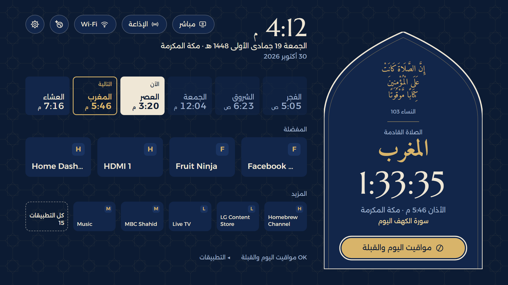
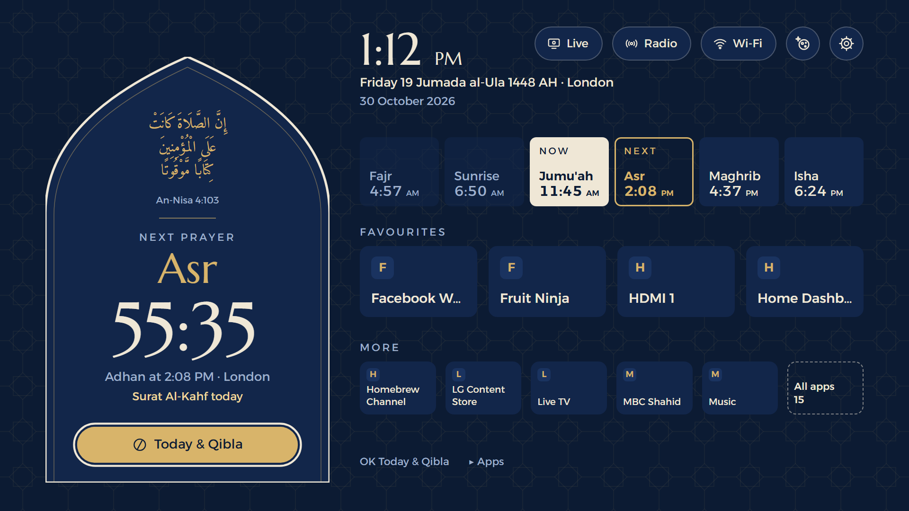
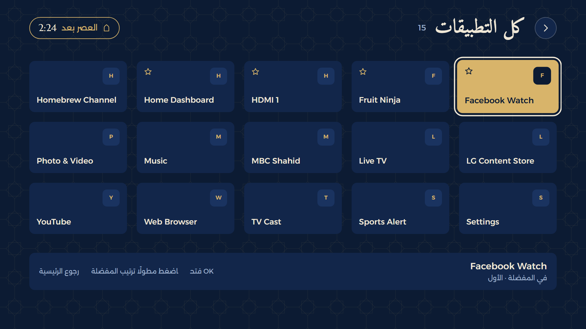
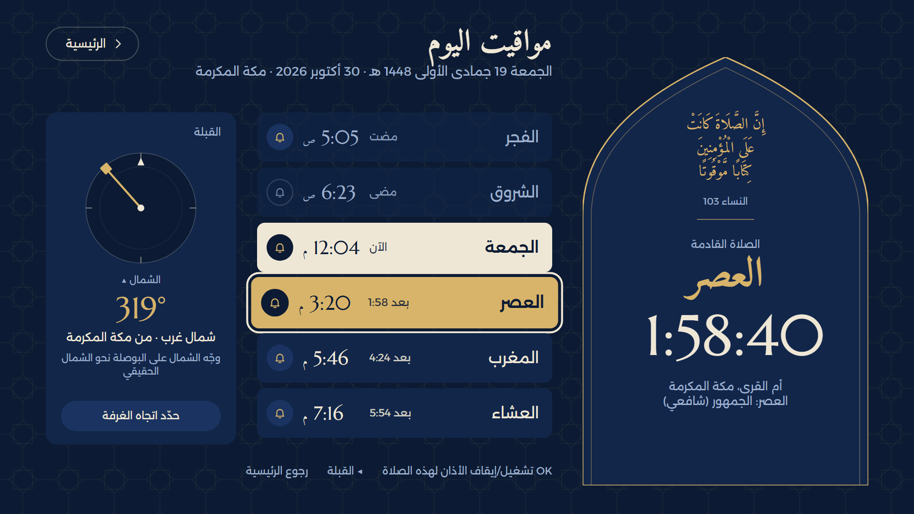
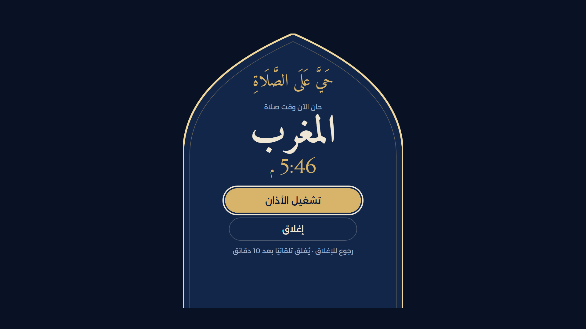
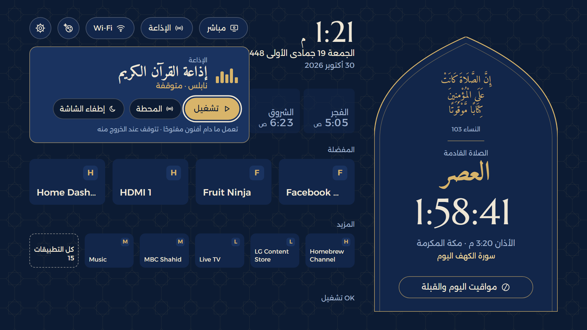
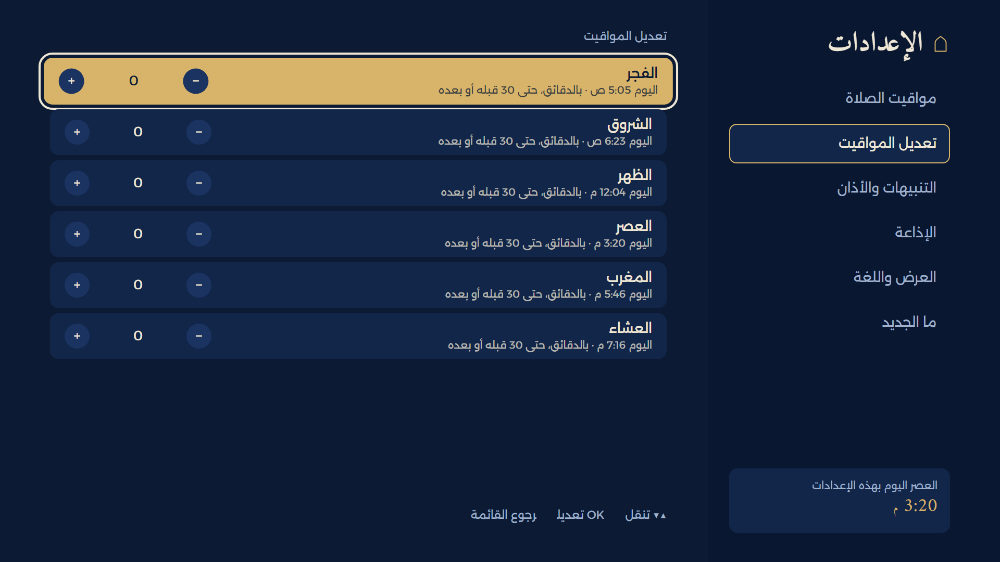
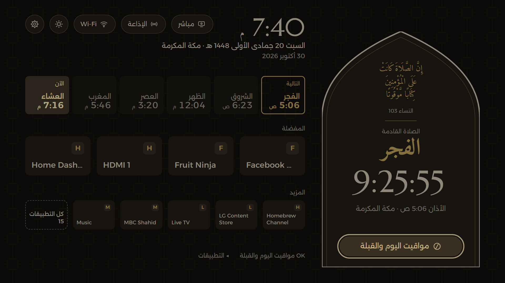

<div dir="rtl">

بسم الله الرحمن الرحيم

والصلاة والسلام على رسول الله، أما بعد:

# Islamic Launcher for LG TV: الشاشة الرئيسية الإسلامية لتلفاز LG

**[جرّبه في المتصفح](https://alequab.github.io/islamic-launcher-for-lg-tv/)** · **[أحدث إصدار](https://github.com/alequab/islamic-launcher-for-lg-tv/releases/latest)** · [التثبيت](#install)

مبني على أفنون، ويجعله الشاشةَ الرئيسية لتلفاز LG: يفتح وحده عند تشغيل التلفاز قبل أي مدخل HDMI، وفيه الصلاة
القادمة والعدّ التنازلي في المحراب، ومواقيت اليوم، والأذان في وقته، وإذاعات القرآن الكريم، والبث المباشر من الحرمين،
ثم تطبيقاتك المفضلة والمزيد وكل التطبيقات.



> **أفنون من إنشاء [egyjs](https://github.com/egyjs)**:
> [egyjs/afnon-android-tv-launcher](https://github.com/egyjs/afnon-android-tv-launcher). التصميم والمزايا منه،
> وهذا المستودع ينقلها إلى تلفازات LG بالرخصة نفسها (MIT). شكرًا لـ egyjs.

يعمل على تلفازات LG بنظام webOS 5 فأحدث، **بعد الروت** (Homebrew Channel).

## المزايا

- **يفتح أولًا** عند تشغيل التلفاز وبعد كل إطفاء وتشغيل، قبل مدخل HDMI والبث التلفزيوني.
- **تطبيقاتك:** أربعة في المفضلة، وخمسة في «المزيد»، ثم «كل التطبيقات» بأيقوناتها، مع التلفاز ومدخلَي HDMI والإعدادات.
  اضغط مطولًا على OK لترتيب المفضلة.
- **الأذان في وقته:** يفتح فوق أي تطبيق أو مدخل HDMI بالصوت الذي تختاره (١٦ صوتًا منها أذان المسجد النبوي)، ثم يعود
  إلى ما كنت تشاهده.
- **التنبيهات بالصوت:** «اقترب موعد صلاة …» قبل الصلاة، و«حان الآن موعد صلاة …» للصلاة التي أذانها متوقف، و«أوشك وقت
  صلاة … على الانتهاء» قبل خروج الوقت بالمدة التي تختارها.
- **مواقيت دقيقة بلا إنترنت:** ١٩٢ مدينة في ٤٣ دولة، ولكل مدينة طريقة الحساب المعتادة فيها، ومنها طريقة وزارة الأوقاف
  العُمانية، والعشاء في رمضان بعد المغرب بساعتين في مدن السعودية، وقاعدة المدن الشمالية في الصيف. ويُعدَّل كل وقت
  بالدقائق (+ ٢ −) ليطابق مسجدك.
- **اليوم الهجري يبدأ من المغرب:** ومعه رمضان، وسورة الكهف من مغرب الخميس، والجمعة حتى مغربها.
- **إذاعات القرآن الكريم والقرّاء،** و**البث المباشر من مكة المكرمة والمدينة المنورة** بدقة 1080p بضغطة واحدة.
- **الوضع الليلي** لكل الشاشات، حتى أيقونات التطبيقات.
- **يتحدّث وحده** من إصدارات هذا المستودع مرة في اليوم.
- **لا حسابات ولا إعلانات ولا تتبّع.**

## التثبيت

الخطوات والأوامر في قسم **Install** بالإنجليزية أدناه.

</div>

---

# Islamic Launcher for LG TV

**[Try it in your browser](https://alequab.github.io/islamic-launcher-for-lg-tv/)** · **[Latest release](https://github.com/alequab/islamic-launcher-for-lg-tv/releases/latest)** · [Install](#install)

Built on Afnon: Afnon as the Home screen of an LG TV. It opens by itself when the TV turns on, before any HDMI
input, with the next prayer and its countdown in a mihrab arch, today's times, the adhan at prayer time, Quran
radio and live Makkah and Madinah, then your favourite apps, more apps and All apps.

> **Afnon was created by [egyjs](https://github.com/egyjs)**:
> [egyjs/afnon-android-tv-launcher](https://github.com/egyjs/afnon-android-tv-launcher). The design and the
> features come from egyjs's Afnon; this repository brings them to LG TVs under the same MIT licence.

Works on LG TVs with webOS 5 or newer, **rooted** with [Homebrew Channel](https://github.com/webosbrew/webos-homebrew-channel).

## Screens

| | |
|---|---|
|  |  |
| **Home.** The next prayer in the arch, today's six times, favourites and more apps; Live, Radio and Wi-Fi at the top. | **All apps.** Every app with its icon. Hold OK to arrange favourites. |
|  |  |
| **Today's prayers and the Qibla**, with an adhan bell for each prayer. | **The call to prayer**, over whatever is on; then back to it. |
|  |  |
| **Quran radio,** from its pill: Play, Station, Screen off. | **Adjust the times:** each time minutes earlier or later, to match your mosque. |
|  | |
| **Night mode,** here on Friday evening: the Hijri date is already Saturday's, and the strip says Dhuhr again. | |

## Features

- **First on screen** when the TV turns on, from standby or a restart, with no HDMI input or Live TV before it.
- **Your apps:** four favourites on Home, five more apps, then **All apps** with their icons, plus Live TV, the
  HDMI inputs and the TV's Settings. Hold **OK** on an app to move a favourite or put an app in its place.
- **The adhan at prayer time** opens over any app or HDMI input with the voice you pick (16 voices, Masjid
  an-Nabawi's among them, and a separate Fajr voice), then goes back to what was on.
- **Spoken lines:** «اقترب موعد صلاة …» before a prayer, «حان الآن موعد صلاة …» when a prayer whose adhan is off
  begins, and «أوشك وقت صلاة … على الانتهاء» before the current prayer's time ends (Fajr at sunrise, Isha at
  Fajr), each with its own setting.
- **Prayer times offline** for 192 cities in 43 countries, each on the method its mosques use: Umm al-Qura (with
  Isha two hours after Maghrib in Ramadan), Egypt, MWL, Karachi, ISNA, Dubai, Kuwait, Qatar, Singapore, the
  Moonsighting Committee and Oman's Ministry of Awqaf; the Asr school; summer nights above 48° by a seventh of the
  night. **Adjust the times** moves each one up to 30 minutes, to match your mosque.
- **The Hijri day starts at Maghrib**, and Ramadan, Surat al-Kahf (Thursday's Maghrib to Friday's) and Jumu'ah
  (Friday until its Maghrib) follow it. A Hijri adjustment of ±2 days for local moon sighting.
- **Quran radio** (Quran stations and ten reciters' channels) and **live Makkah and Madinah** in up to 1080p,
  with Screen off while listening.
- **Night mode** on every screen, app icons dimmed too.
- **Arabic and English**, Western or Eastern digits, 12 or 24 hours.
- **Updates itself** from this repository's releases, once a day.
- **The remote:** the arrows and OK do everything; with a Magic Remote the pointer works too.
- **No accounts, ads or tracking.** Only the radio, the live video and the daily update check use the internet.

## How it works

webOS doesn't let an app become the Home screen or list other apps, so a small boot script
(`boot/90-afnon-launcher`, which Homebrew Channel runs at every boot) does what the app can't:

1. Gives the launcher the permissions to list and open apps, read the network name and use Afnon's service, and
   lets the service see what is on screen so the adhan can go back to it.
2. Copies each app's icon into the launcher's folder (the TV doesn't let a web app read other apps' folders),
   again whenever an app is installed or removed.
3. Opens the launcher when the TV turns on, and makes it the TV's "last input" as it turns off, so the TV starts
   on it.
4. Checks this repository's latest release once a day and installs it when it's newer, keeping the TV's adhan
   recordings, which releases don't carry.

The adhan and reminders are scheduled by the service of [Afnon for LG webOS](https://github.com/alequab/afnon-webos),
so that app must be installed too; the launcher tells it which app to open for the call. The Home button still
opens LG's own Home bar.

<a id="install"></a>
## Install

You need:

- An LG TV with webOS 5 or newer, rooted, with Homebrew Channel and its root telnet on (the default).
- [Afnon for LG webOS](https://github.com/alequab/afnon-webos) installed first: its service schedules the adhan
  and reminders.
- A Windows PC on the same network with [Node.js](https://nodejs.org) and LG's tools: `npm install -g @webos-tools/cli`.

Then, from this folder:

1. Copy `app/sounds` from your Afnon for LG webOS folder (after its `tools\fetch-adhans.ps1`); without it the adhan
   is silent. Updates keep these files on the TV.
2. Package and install, with the boot script:
   ```powershell
   powershell -ExecutionPolicy Bypass -File tools\install-tv.ps1 -Tv <TV IP>
   ```
   The TV downloads the package from your PC; Windows may ask once to let Node through its firewall.

From then on the TV updates itself. To check for an update at once, on the TV's root shell:
`/var/lib/webosbrew/init.d/90-afnon-launcher update`.

To remove it: delete `/var/lib/webosbrew/init.d/90-afnon-launcher` and `/var/lib/afnon-launcher` on the TV and
uninstall **Islamic Launcher for LG TV**.

## Releasing

1. Set `version` in `app/appinfo.json` and move the changelog's Unreleased section under it.
2. `powershell -ExecutionPolicy Bypass -File tools\release.ps1` builds `output\release\tv.afnon.launcher_<version>_all.ipk`
   without the recordings.
3. `gh release create v<version> output\release\tv.afnon.launcher_<version>_all.ipk --notes-file <notes>`.
   TVs pick it up within a day.

## Trying things in a browser

`node tools/serve.js` serves the launcher at http://localhost:8720 with the TV stubbed (arrows, Enter, Esc).
Test hooks in the address: `locale=ar|en`, `digits=western|eastern`, `set=city:makkah,night:1`,
`open=day|settings|apps|radio`, `at=<ISO time>` (the clock jumps there), `call=<prayer>&time=<ms>` (the call screen),
`live=makkah`, `keys=down,ok,back`, `cityclock=1` (the city's clock, not the browser's) and `shot=1` (unscaled).
The website is `site/` with the screenshots and the app itself as its demo; `tools\site.ps1` builds it and
publishes it to the `gh-pages` branch, which GitHub Pages serves.

## Project layout

```
app/                  the launcher (a webOS web app: index.html, js/, css/, fonts/)
  js/app.js           every screen: Home, All apps, Prayer day, Settings, the call, radio, live
  js/prayer.js        prayer times (adhan-js), the 192 cities, time zones
  js/text.js          every string in Arabic and English
boot/90-afnon-launcher the boot script: permissions, icons, first on screen, updates, sounds
tools/                install-tv.ps1, release.ps1, site.ps1, tv-shell.js (root shell over telnet), serve.js
site/                 the website; docs/screenshots/ its images
```

## Credits

The same as [Afnon for LG webOS](https://github.com/alequab/afnon-webos): see [THIRD_PARTY.md](THIRD_PARTY.md).
Rules from [meypod/al-azan](https://github.com/meypod/al-azan) (Umm al-Qura in Ramadan, high latitudes, adjusting
the times), rebuilt here. Released under the [MIT licence](LICENSE).
